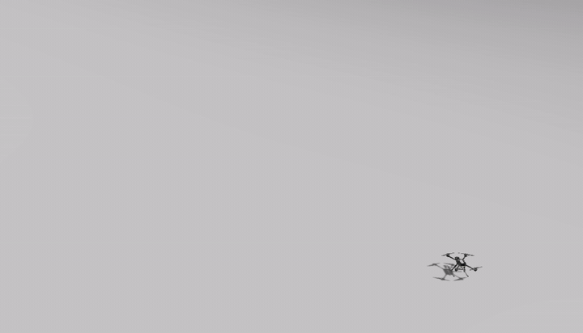

# UAV Autonomous Target Tracking

Autonomous UAV target tracking with obstacle avoidance and visual-inertial localization, built with ROS 2, PX4 and Gazebo.

> 🚧 Work in progress — v0.1 (offboard control) complete; now working on v0.2 (target detection and tracking).

## Goal

A simulated quadrotor that detects and follows a moving target in an unknown environment, planning collision-free trajectories while localizing itself with visual-inertial odometry.

## Roadmap

- [x] **v0.1** — PX4 + ROS 2 integration, offboard control
- [ ] **v0.2** — Target detection and tracking
- [ ] **v0.3** — Local planning and obstacle avoidance
- [ ] **v0.4** — Visual-inertial localization (replacing ground truth)
- [ ] **v1.0** — Full integration and evaluation

## Current Status: Offboard Mission (v0.1)
 

 
The drone takes off, flies a 5 m square at a constant cruise speed and lands back at the
start position, fully commanded from ROS 2 through PX4 offboard mode.

See [`uatt_px4_interface`](uatt_px4_interface/README.md) for the mission state machine,
the design decisions and how to run it.

## Stack

| Component | Version |
|---|---|
| Ubuntu | 24.04 |
| ROS 2 | Jazzy |
| PX4 Autopilot | v1.17.0 |
| Gazebo | Harmonic |
| px4_msgs | release/1.17 |
| Micro XRCE-DDS Agent | v2.4.3 |

## Packages

| Package | Description |
|---|---|
| `uatt_px4_interface` | Bridge between PX4 and the rest of the stack |

## Author

Jorge Vargas — Mechatronics Engineer