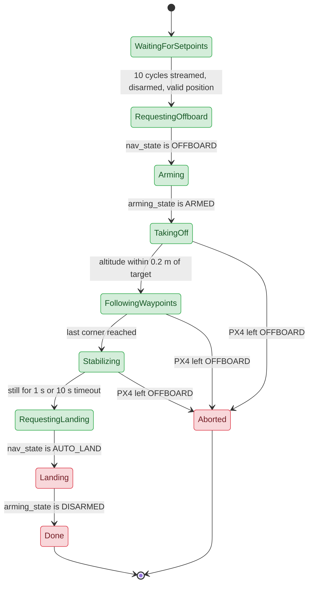

# uatt_px4_interface

Bridge between PX4 and the rest of the stack: commands the vehicle in offboard mode and
monitors its state through the PX4 uXRCE-DDS bridge.

## Nodes

### `offboard_control`

Runs a complete offboard mission as a state machine on a 10 Hz control loop: requests
offboard mode, arms, takes off to 2 m above the start position, flies a 5 m square in the
north-east plane at a constant cruise speed and lands back at the start position.

Every request to PX4 (mode change, arming, landing) is retried until PX4 confirms it through
`VehicleStatus`, and any exit from offboard mode aborts the mission and hands control back
to PX4.



| Color | Meaning |
| :--- | :--- |
| 🟩 Green | The node is in control: it streams the offboard heartbeat and position setpoints at 10 Hz. |
| 🟥 Red | PX4 is in control: the node stops streaming and only monitors the vehicle. |

#### Key design decisions

- **Retries with confirmation:** `DO_SET_MODE`, `ARM` and `NAV_LAND` are resent every second until the matching `VehicleStatus` field confirms them, because the PX4 bridge is best-effort and a single command can be lost.
- **Separate `RequestingLanding` state:** the node keeps streaming until PX4 confirms `AUTO_LAND`, so the offboard-loss failsafe never competes with the landing request.
- **Moving setpoint with velocity feedforward:** along each side of the square the setpoint advances at a constant cruise speed and its velocity is sent as feedforward, so PX4 tracks it closely instead of jumping 5 m at once.
- **Waypoints anchored at the start position:** the square is computed once from the position where the mission starts, in PX4's local NED frame.

#### Topics

| Direction | Topic | Type |
| :--- | :--- | :--- |
| Subscribes | `/fmu/out/vehicle_status_v1` | `px4_msgs/msg/VehicleStatus` |
| Subscribes | `/fmu/out/vehicle_local_position_v1` | `px4_msgs/msg/VehicleLocalPosition` |
| Publishes | `/fmu/in/offboard_control_mode` | `px4_msgs/msg/OffboardControlMode` |
| Publishes | `/fmu/in/trajectory_setpoint` | `px4_msgs/msg/TrajectorySetpoint` |
| Publishes | `/fmu/in/vehicle_command` | `px4_msgs/msg/VehicleCommand` |

#### Mission settings

Currently compile-time constants in `src/offboard_control.cpp` (to be exposed as ROS 2 parameters):

| Constant | Value | Description |
| :--- | :--- | :--- |
| `kTakeoffAltitudeM` | 2.0 m | Flight altitude above the start position |
| `kSquareSideM` | 5.0 m | Side length of the square |
| `kCruiseSpeedMps` | 1.0 m/s | Setpoint speed along each side |
| `kWaypointToleranceM` | 0.3 m | Distance at which a corner is considered reached |
| `kControlPeriod` | 100 ms | Control loop period |

### `vehicle_status_monitor`

Subscribes to `/fmu/out/vehicle_status_v1`, prints a full snapshot of the vehicle state on the
first message and then logs only the fields that change: arming state, navigation state,
failsafe, pre-flight checks, GCS connection and the latest arming/disarming reasons.

## Usage

Build from the workspace root:

```bash
cd ~/uatt_ws
colcon build --packages-select uatt_px4_interface
source install/setup.bash
```

Run each command in its own terminal:

```bash
# 1. uXRCE-DDS agent (bridge between PX4 and ROS 2)
MicroXRCEAgent udp4 -p 8888

# 2. PX4 SITL with Gazebo
cd ~/PX4-Autopilot && make px4_sitl gz_x500

# 3. Offboard mission
ros2 run uatt_px4_interface offboard_control

# Optional: state monitor
ros2 run uatt_px4_interface vehicle_status_monitor
```